<p align="center">
  
</p>

<h1 align="center">ServoBuddy</h1>

<p align="center">
  <b>Your car's logbook, in your pocket.</b><br>
  Services, rego, insurance and every dollar your car costs, in one place.
  Reminders before anything falls due. Offline, private, no account.
</p>

<p align="center">
  <a href="https://github.com/SarveshP16/ServoBuddy/releases/latest"></a>
  
  
  <a href="LICENSE"></a>
  <a href="https://ko-fi.com/crystaxit"></a>
</p>

<p align="center">
  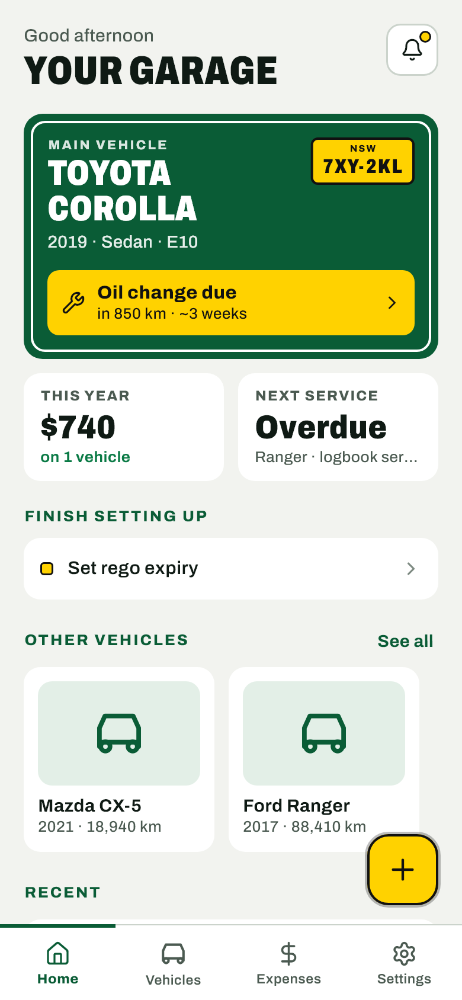
  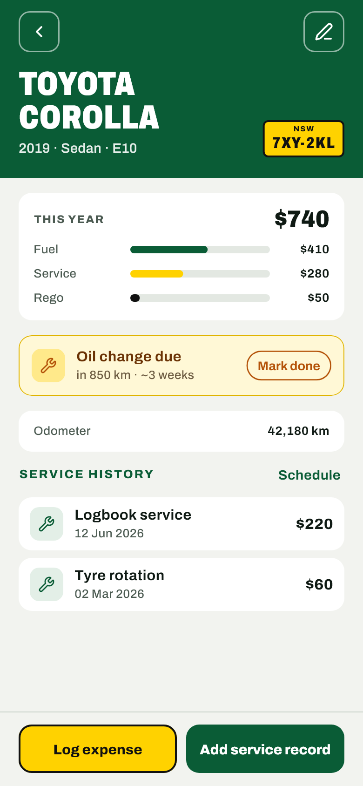
  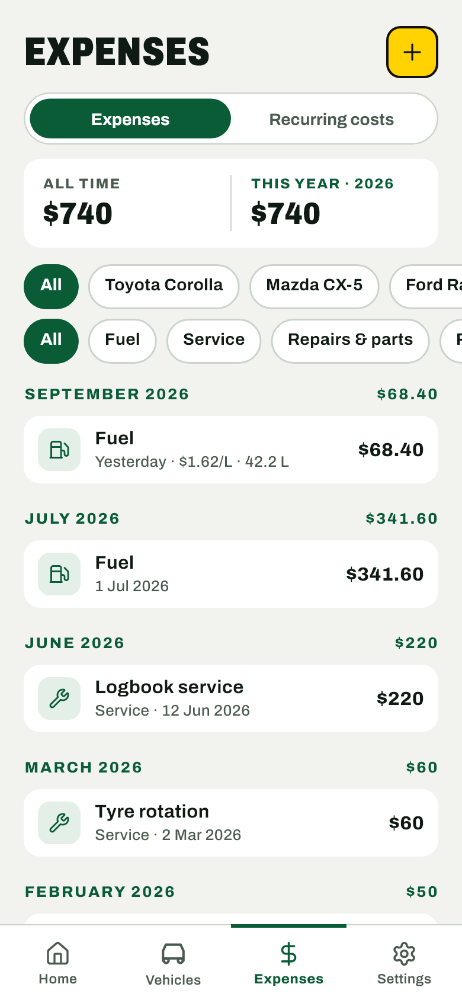
  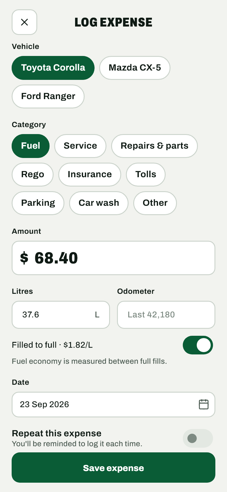
</p>

<p align="center"><sub>Screenshots use made-up demo data.</sub></p>

## Contents

- [Features](#features)
- [Screenshots](#screenshots)
- [Download and install](#download-and-install)
- [How to use it](#how-to-use-it)
- [Build from source](#build-from-source)
- [Development](#development)
- [Support the project](#support-the-project)
- [Changelog](#changelog)
- [Licence](#licence)

## Features

### Your garage
- Any number of cars: make, model, year, body type, fuel type, rego plate,
  odometer, a photo, and rego and insurance expiry dates.
- A **main vehicle** gets the road-sign panel on Home: its name, its plate,
  and where its servicing stands.
- **Finish setting up** lists what your main car is still missing (odometer,
  rego expiry, service reminders) until it's filled in.
- **Sold / not in use**: a sold car moves to its own section, its reminders
  stop, and its page shows what it cost you against the sale price. "Put back
  in use" restores it.
- **Two kinds of delete**: remove a car but keep its expense history, or
  remove everything.

### Expenses
- **One form** for fuel, services, rego, insurance, repairs and parts,
  tolls, parking, car wash and anything else. Attach receipt photos.
- **Fuel fills** record litres, odometer and "filled to full". The price per
  litre updates as you type.
- **Fuel economy** (L/100 km) and fuel cost per km, worked out the
  full-to-full way.
- All-time and yearly totals, grouped by month, filterable by year, car and
  category. Swipe left to delete, with Undo.

### Recurring costs
- Insurance, toll passes, subscriptions: set the amount and how often.
- On each due date you get a reminder and a "Log $120" card. Nothing is
  logged until you tap Log, Edit or Skip.
- See roughly what they add up to over a year.

### Service reminders
- Each car has its own schedule of "every X km or Y months, whichever comes
  first", with one-tap presets (logbook service, oil, tyres, brakes…).
- Due dates are estimated from how fast your odometer is actually rising, so
  "~3 weeks" adjusts as you drive more or less.
- Marking a service done logs it as an expense and resets the reminder.

### Notifications
- Service, rego and insurance: a reminder 2 weeks before and on the day, at
  9 am.
- **NSW CTP green slip** (3 weeks before rego) and **pink slip** (when the
  inspection window opens, for cars 5+ years old). Both follow the rego date.
- A **Coming up** list on Home shows everything due soon across all cars.

### Backup and restore
- **Back up now** saves everything to one `.zip` file: vehicles, expenses,
  reminders, recurring costs, photos, receipts, your theme and Home title.
- Save it wherever you like: Downloads, a USB stick, Google Drive.
- **Restore** brings it all back on a new phone or after a reset.
- Settings shows when you last backed up.

### Private by design
- Everything lives on your phone, in a local database. No account, no
  sign-up, no cloud, no ads, no tracking.
- The app doesn't even ask for internet access.

### Road Sign look
- Sign green, number-plate yellow and condensed headings, in **Light** and
  **Dark**, or matching your phone.

## Screenshots

| Home | Vehicle | Expenses | Settings |
|:---:|:---:|:---:|:---:|
|  |  |  | 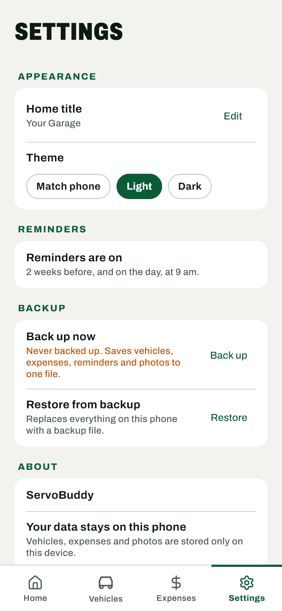 |
| 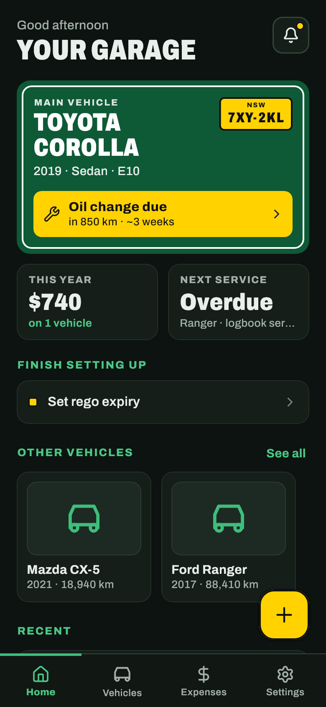 | 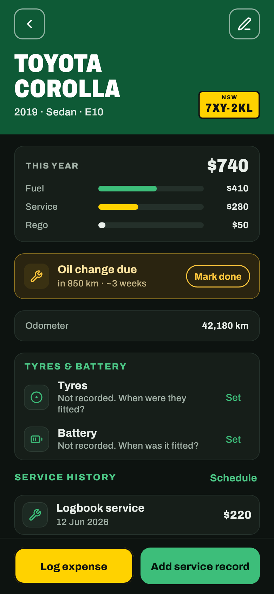 | 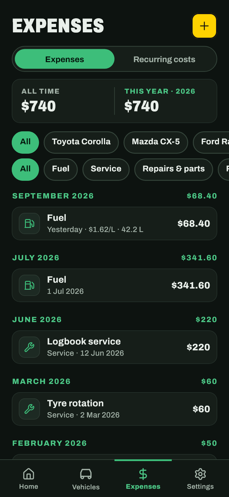 | 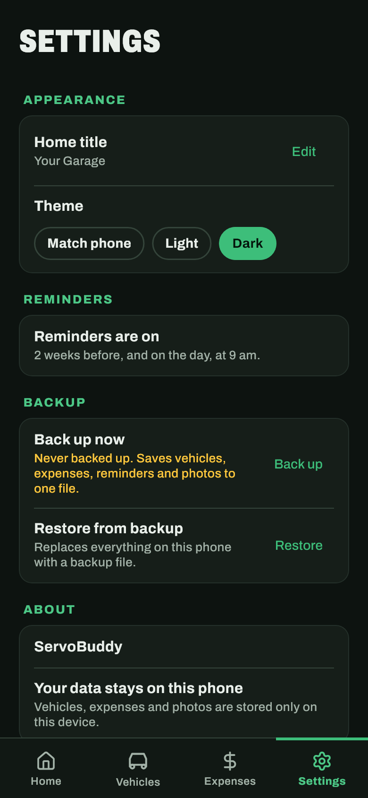 |

| Vehicles | Log expense | Recurring costs | Sold car |
|:---:|:---:|:---:|:---:|
| 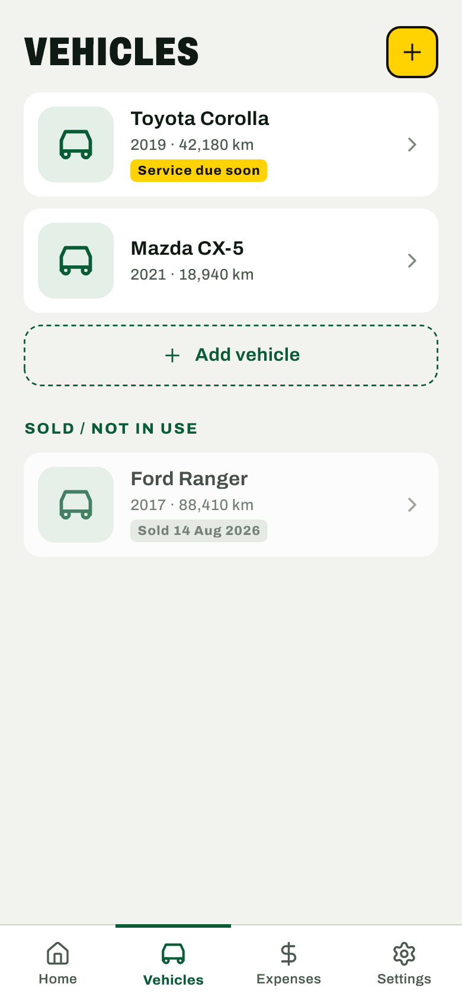 |  | 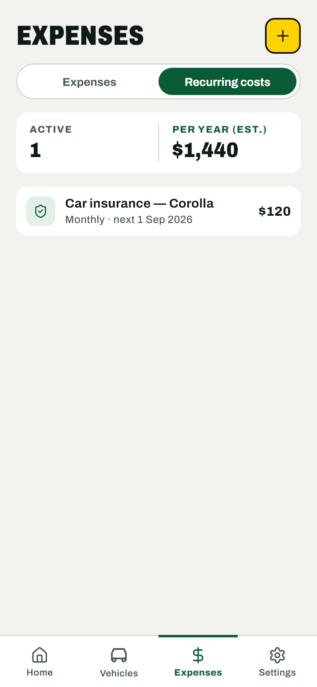 | 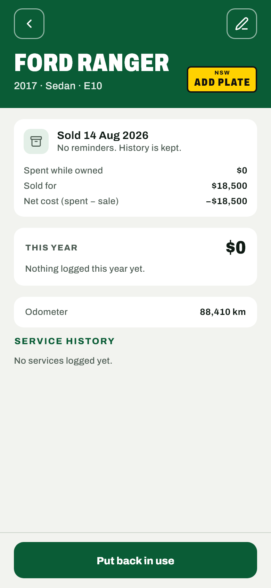 |

## Download and install

ServoBuddy is an Android app (Android 7.0 or newer).

1. Open the [latest release](https://github.com/SarveshP16/ServoBuddy/releases/latest)
   on your phone and download the `.apk` file.
2. Open it. If Android asks, allow your browser or file manager to
   **install unknown apps**.
3. Tap **Install**.

**Updating:** install the new `.apk` over the old one. Your data stays.

## How to use it

1. **Add your car.** Make, model, year and the current odometer reading.
   Add the rego plate and expiry date to get rego, green slip and pink slip
   reminders.
2. **Set up service reminders.** Open the car, tap **Set up service
   reminders**, and pick presets like "Logbook service" or "Oil change".
   Enter when each was last done.
3. **Log expenses.** Tap the yellow **+** on Home. Pick the car and the
   category, enter the amount. For fuel, add litres and the odometer to get
   economy figures.
4. **Mark services done.** When a service is due, tap **Mark done** on the
   car's page. It's logged as an expense and the reminder resets.
5. **Add recurring costs.** Expenses → **Recurring costs** → **+**. When one
   comes due, a card on Home asks you to log it.
6. **Back up.** Settings → **Back up now**, and save the file somewhere safe.
   To restore, Settings → **Restore from backup** and pick the file. Restoring
   replaces everything on the phone.
7. **Sold a car?** Edit it → **Mark as sold / not in use**. Its history stays.

## Build from source

You need the [Flutter SDK](https://docs.flutter.dev/get-started/install)
(Dart 3.13 or later) and an Android device or emulator.

```sh
git clone https://github.com/SarveshP16/ServoBuddy.git
cd ServoBuddy
flutter pub get
flutter run
```

### Release APK

Release builds are signed with the keystore named in `android/key.properties`.
Both are git-ignored. Create your own keystore:

```sh
keytool -genkeypair -v -keystore android/app/servobuddy-release.jks \
  -keyalg RSA -keysize 2048 -validity 10000 -alias servobuddy
```

Then create `android/key.properties`:

```properties
storePassword=<your password>
keyPassword=<your password>
keyAlias=servobuddy
storeFile=servobuddy-release.jks
```

Build:

```sh
flutter build apk --release
```

The APK is written to `build/app/outputs/flutter-apk/app-release.apk`.
Without `key.properties`, release builds fall back to the debug key.

Keep a copy of the keystore and its password. Without them you can't ship an
update that installs over an existing copy of the app.

## Development

```sh
flutter analyze
flutter test
dart run build_runner build   # after changing lib/core/database/tables.dart
flutter test test/preview_test.dart --update-goldens   # re-render test/preview/*.png
```

`test/preview/` holds a render of each screen in light and dark, built from
demo data in `test/support/seed.dart`. These are the screenshots above. The
preview test is skipped in normal test runs.

### Tech stack

- [Flutter](https://flutter.dev) with [Riverpod](https://riverpod.dev) for
  state and [go_router](https://pub.dev/packages/go_router) for navigation
- [Drift](https://drift.simonbinder.eu) (SQLite) for the local database, with
  tested schema migrations
- [flutter_local_notifications](https://pub.dev/packages/flutter_local_notifications)
  for reminders
- [file_picker](https://pub.dev/packages/file_picker) and
  [archive](https://pub.dev/packages/archive) for backups
- [Lucide](https://lucide.dev) icons and the
  [Archivo](https://github.com/Omnibus-Type/Archivo) font

### Project layout

```
lib/
├── app/          App root, router, bottom navigation
├── core/         Database, theme, formatters, calendar maths,
│                 notifications and shared widgets
└── features/
    ├── backup/     Backup files: create and restore
    ├── expenses/   Expenses, recurring costs, fuel economy
    ├── garage/     Snapshot of all data with derived values
    ├── home/       Home tab
    ├── reminders/  Reminder planning, green and pink slips, Coming up
    ├── service/    Service schedules and due estimates
    ├── settings/   Theme, Home title and preferences
    └── vehicles/   Add, edit, sell and delete cars
```

Each feature is split into `domain/` (plain Dart logic), `data/`
(repositories and storage), `application/` (providers and actions) and
`presentation/` (screens and widgets).

## Support the project

ServoBuddy is free and has no ads. If it saves you a missed rego or a
forgotten service, you can buy me a coffee:

<a href="https://ko-fi.com/crystaxit"></a>

Bug reports and ideas are welcome in
[Issues](https://github.com/SarveshP16/ServoBuddy/issues).

## Changelog

See [CHANGELOG.md](CHANGELOG.md) for every release.

**1.2.0** — Road Sign redesign, backup and restore, and fully offline (the
fuel price finder was removed).

## Licence

ServoBuddy is released under the [MIT Licence](LICENSE).

The bundled Archivo font is under the
[SIL Open Font License 1.1](assets/fonts/Archivo-OFL.txt). Lucide icons are
under the [ISC Licence](https://lucide.dev/license).
